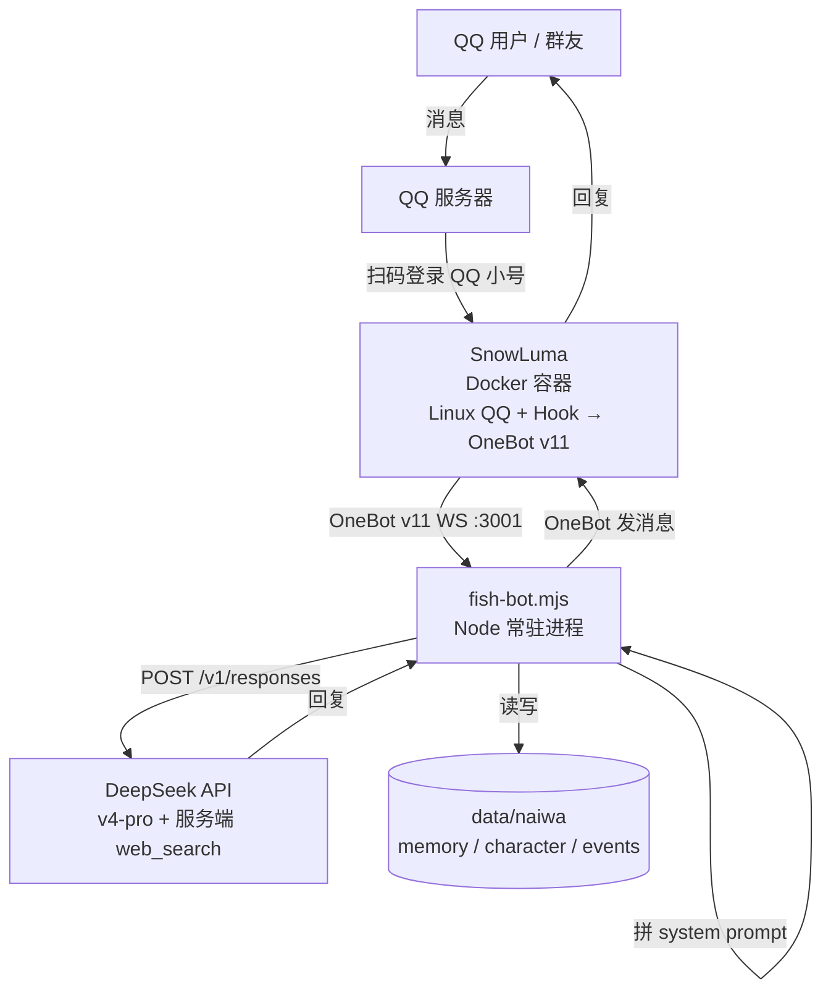

# 架构与消息流

## 一句话

**QQ 只是线，线那头是 fish-os 里的「奶蛙」：人格 + 记忆 + 联网，靠 DeepSeek Responses API 说话。**

## 消息流（ASCII）

```
[你的 QQ 主号] --私聊/群聊--> [QQ 服务器]
                                  │  扫码登录（QQ 小号）
                                  ▼
┌────────────────────────────────────────────────────────────┐
│ SnowLuma（Docker 容器 · 本机 127.0.0.1）                      │
│   Linux QQ 客户端（Xvfb + noVNC 扫码）                       │
│   Hook 注入 QQ 进程 → 转成 OneBot v11                        │
│   端口：6081 noVNC · 5099 WebUI · 3000 HTTP · 3001 WS        │
└────────────────────────────────────────────────────────────┘
                                  │  OneBot v11 事件（消息）
                                  ▼
┌────────────────────────────────────────────────────────────┐
│ fish-bot.mjs（Node 常驻进程 · 本机）                          │
│   收到消息 → 检索记忆 → 拼 system prompt                     │
│     · 人设      persona/naiwa.md                            │
│     · 社交准则  persona/social-rules.md（最高优先级）         │
│     · 长期记忆  fish-os Memory（隐私隔离）                    │
│     · 当前时间  北京时间（问日期/时间直接答，不搜）            │
│     · 短期历史  每个 peer 最近 6 条（3 轮）                    │
│   → 调 DeepSeek Responses API                               │
│   → 写记忆（data/naiwa）                                    │
│   → 经 OneBot 发回 QQ（回复）                                │
└────────────────────────────────────────────────────────────┘
                                  │  POST /v1/responses
                                  │  model: deepseek-v4-pro
                                  │  tools: [{type:"web_search"}]
                                  ▼
┌────────────────────────────────────────────────────────────┐
│ DeepSeek API（服务端）                                        │
│   · 推理模型（先想再答）                                       │
│   · web_search 由服务端执行（查梗/查事实，一次请求内完成）      │
└────────────────────────────────────────────────────────────┘
```

## Mermaid



## 各层职责

| 层 | 角色 | 关键点 |
|---|---|---|
| QQ | 用户入口 | 你用小号登录、主号私聊/群聊 |
| SnowLuma | QQ → OneBot 桥 | Docker 跑 Linux QQ，Hook 注入，暴露 OneBot v11 |
| fish-bot | 数字生命本体 | 收消息、拼人设/记忆/时间/历史、调大脑、写记忆、发回 |
| DeepSeek | 大脑 | Responses API + 服务端 `web_search`（v4-pro 专属） |

## 一条消息的生命周期

1. 你在 QQ 发一句 → QQ 服务器 → SnowLuma 里的 QQ 客户端；
2. SnowLuma Hook 捕获 → 转成 OneBot v11 事件 → WS `:3001` 推给 fish-bot；
3. fish-bot 检索该 peer 可见的记忆 + 拼 system prompt（人设/准则/记忆/时间/历史）；
4. 调 `POST /v1/responses`（v4-pro + 服务端 web_search；模型自决是否搜，搜索在服务端完成）；
5. 拿到回复 → 写入 `data/naiwa`（情节记忆 + 关系）→ 通过 OneBot `send_private_msg` / `send_group_msg` 发回；
6. 失败降级：搜索 500/超时 → 重试 → 退回不搜再答，不把错误抛给用户。

## 存储

```
data/naiwa/
├── memory.json      # 长期记忆（情节/自我；隐私隔离）
├── character.json   # 情绪 / 关系 / 兴趣
└── events.json      # 统一事件（审计/回溯）
```
