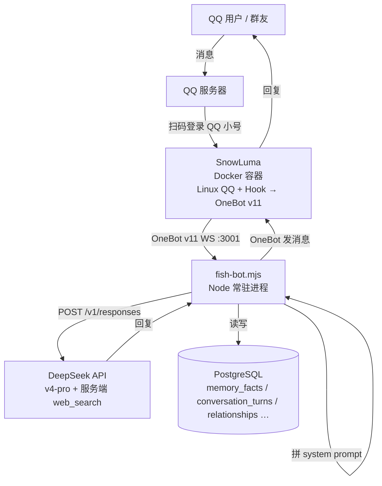

# 架构与消息流

## 一句话

**QQ 只是线，线那头是 fish-os 里的「奶蛙」：人格 + 记忆 + 联网，靠 DeepSeek Responses API 说话。**

## 消息流（ASCII）

```
[你的 QQ 主号] --私聊/群聊--> [QQ 服务器]
                                  │  扫码登录（QQ 小号）
                                  ▼
┌────────────────────────────────────────────────────────────┐
│ SnowLuma（Docker 容器 · 本机 127.0.0.1）                      │
│   Linux QQ 客户端（Xvfb + noVNC 扫码）                       │
│   Hook 注入 QQ 进程 → 转成 OneBot v11                        │
│   端口：6081 noVNC · 5099 WebUI · 3000 HTTP · 3001 WS        │
└────────────────────────────────────────────────────────────┘
                                  │  OneBot v11 事件（消息）
                                  ▼
┌────────────────────────────────────────────────────────────┐
│ fish-bot.mjs（Node 常驻进程 · 本机）                          │
│   收到消息 → 取记得的事 → 拼 system prompt                   │
│     · 人设      persona/naiwa.md                            │
│     · 社交准则  persona/social-rules.md（最高优先级）         │
│     · 记得的事  带出处的事实（按地方取，私聊不进群）           │
│     · 当前时间  北京时间（问日期/时间直接答，不搜）            │
│     · 短期历史  每个会话最近 20 条（24 小时内）                │
│   → 调 DeepSeek Responses API（60 秒内必有结果、花费有上限）│
│   → 经 OneBot 发回 QQ（排队节流，逐条发送）                  │
│   → 确认发出后写原话和关系（PostgreSQL）；后台安静后提炼事实  │
└────────────────────────────────────────────────────────────┘
                                  │  POST /v1/responses
                                  │  model: deepseek-v4-pro
                                  │  tools: [{type:"web_search"}]
                                  ▼
┌────────────────────────────────────────────────────────────┐
│ DeepSeek API（服务端）                                        │
│   · 推理模型（先想再答）                                       │
│   · web_search 由服务端执行（查梗/查事实，一次请求内完成）      │
└────────────────────────────────────────────────────────────┘
```

## Mermaid



## 各层职责

| 层 | 角色 | 关键点 |
|---|---|---|
| QQ | 用户入口 | 你用小号登录、主号私聊/群聊 |
| SnowLuma | QQ → OneBot 桥 | Docker 跑 Linux QQ，Hook 注入，暴露 OneBot v11 |
| fish-bot | 数字生命本体 | 收消息、拼人设/记得的事/时间/历史、调大脑、发回、记原话；后台提炼事实 |
| DeepSeek | 大脑 | Responses API + 服务端 `web_search`（v4-pro 专属） |

## 一条消息的生命周期

1. 你在 QQ 发一句 → QQ 服务器 → SnowLuma 里的 QQ 客户端；
2. SnowLuma Hook 捕获 → 转成 OneBot v11 事件 → WS `:3001` 推给 fish-bot；
3. fish-bot 先判断要不要请模型看（Module 7：明确叫它的、开头叫名字的、正在留意的人说的，其余不说话、只记进内存里的“群里最近的聊天”，见 [Module 7 设计](module-07-group-chat-design.md) 和 [补充设计](module-07b-burst-merge-design.md)），再去重（同一条消息只处理一次），攒进这个会话的“一轮”：这些人停 7 秒没再说（最多等 15 秒或 5 句）就一起看，同一会话同时只有一轮在看；看的时候取这个地方的事实（加上涉及的人在群里说的称呼）、对这一轮发言者的印象、24 小时内的短期历史（都在数据库里），用全局代号拼 system prompt（人设/准则/当前发言者/你记得的事/这一轮/时间），群里刚才在聊的话放在最后一条用户消息里、紧挨着这一轮的几句（见 [调研报告](naiwa-smartness-research.md) 第四节）；
4. 先检查今天的花费是否已达上限、这个会话是否调用太频繁，再调 `POST /v1/responses`（v4-pro + 服务端 web_search；模型自决是否搜，搜索在服务端完成），用量按官方价格估算后入账；
5. 拿到回复（可以不回，也可以回几个人、最多 3 条，每条写明回谁）→ 进入发送节流队列 → 通过 OneBot `send_private_msg` / `send_group_msg` 逐条发回 → 确认发出后写入 PostgreSQL（原话一句一行 + 关系）；会话安静 10 分钟后，后台用 deepseek-flash 从原话里提炼事实（见 [记忆 v2 设计](memory-v2-design.md)）；
6. 失败降级：第一次失败（超时、限流、服务端错误、空回复）就换“不搜索、不思考”再试一次，60 秒内必有结果；仍然失败时只发固定提示，不把错误原文发给用户。

## 传输层（OneBot 客户端）

fish-bot 与 SnowLuma 之间只有一条正向 WebSocket 连接，由 `src/adapters/onebot.js` 维护：

- 断线自动重连：指数退避，1 秒到 30 秒；
- 每个请求都有超时；
- 收不到数据时发 `get_status` 探测，发现假活连接就重连；
- 坏数据只记日志，不会让进程崩溃；
- 所有发送经过节流队列，相邻两条至少间隔 1.5 秒，每分钟最多 20 条。

每条消息的处理过程用 `messageKey` 串在日志里。详见 [Module 3 导读](module-03-onebot.md)。

## 模型调用（DeepSeek 适配器）

`src/model/` 负责调用模型本身，处理器只拿到可以发出的文字，或者说明原因的 `ModelError`：

- 一次回复（含重试）最多 60 秒；最多两次尝试，第二次不搜索、不思考；
- HTTP 200 也检查 `status`：生成失败会重试，被截断时保留到最后一个完整句子，被内容过滤时发婉拒提示；
- 每次调用按官方价格估算花费，记进 `model_usage` 表；今天的花费达到上限（默认 20 元）后不再调用模型；
- 每个会话每分钟最多 10 次、每小时最多 120 次；
- 错误信息是固定说明，不带对方返回的原文。

详见 [Module 4 导读](module-04-model.md)。

## 消息处理运行时

`src/runtime/` 决定消息按什么顺序、以什么方式处理：

- 每个会话把要看的几句攒成“一轮”一起看（`round-queue.js`，见 [补充设计](module-07b-burst-merge-design.md)）；同一会话同时只有一轮在看，看的时候来的攒进下一轮，后一轮看得到前一轮的对话；不同会话并行，同时最多 4 个；下一轮最多攒 5 句；
- 每条叫到奶蛙的消息记进 `inbound_messages`：24 小时内同一条只处理一次，重启后也能识别；处理结果如实记录，发送失败不会被记成已回复；
- 超过 3 分钟的消息不再回复；
- 没连上 OneBot、肯定没发出的回复，等重连后补发一次；结果未知的不重发；
- 退出时等手上的消息处理完（最多 10 秒），启动时把上次没处理完的标为中断。

详见 [Module 5 导读](module-05-runtime.md)。

## 上下文与记忆

见 `src/context/`、`src/memory/`：

| 内容 | 可见范围 |
| --- | --- |
| 对这个人的印象（代号、昵称、熟不熟） | 跟着人走：任何群和私聊都放进提示；群里只按群聊互动算 |
| 记得的事（称呼、个人情况、近况、群事） | 按地方：这个群或这个私聊的事实；只有群里说的称呼能带到别的群 |
| 私聊内容（历史、事实） | 只在该私聊，永远不进任何群 |

- 每个人一个全局、持久的代号（u1、u2…），任何会话里都一样。只给奶蛙处理的消息里的人分配（说话的人和被 @ 的人）；“群里最近的聊天”里只在旁边说话的人不分配，提示里临时叫 x1、x2；
- 短期历史存在数据库里，重启不丢，只取 24 小时内的最近 3 轮；
- 运行锁：同一个数据库同时只有一个机器人；原话、关系、代号、事实、提炼进度只经持锁连接写入，连接一断机器人立即退出。

详见 [Module 6 导读](module-06-context.md) 和 [记忆 v2 设计](memory-v2-design.md)。

## 部署与可观测性

见 [部署与运维](deploy.md)。`docker compose` 里四个服务：`db`（PostgreSQL）、`bot`（奶蛙）、`backup`（每天 4 点备份、做恢复演练）、`alert`（每 5 分钟查一次，出问题 QQ 私聊加 Bark 推到手机）；SnowLuma 在自己的 compose 里，奶蛙经它的 Docker 网络连。日志每天一个文件（`logs/`，留 14 天），`npm run trace` 按群、人、时间查一句话走到了哪一步和当时的状态。

## 存储

PostgreSQL（`docker compose` 的 `db` 服务，只监听 127.0.0.1），表结构见 `migrations/`：

| 表 | 内容 |
| --- | --- |
| `events` | 统一事件（审计/回溯，只追加） |
| `character_state` | 角色创建时间 |
| `mood_state` | 奶蛙的心情：今天的基调、日内起伏（每个租户一行，不按群、不按人，见 [Module 8 设计稿](module-08-mood-design.md)） |
| `interests` | 兴趣及权重 |
| `relationships` | 每个人的关系：互动次数（另记群聊次数）、第一次见面时间（不记好感） |
| `model_usage` | 模型用量账本：按北京时间的日期、会话、模型累计调用次数、token、搜索次数和估算花费（不存内容） |
| `inbound_messages` | 入站消息记录：每条叫到奶蛙的消息的处理状态和结果，用于去重（不存内容，保留 30 天） |
| `person_aliases` / `person_alias_counters` | 全局、持久的代号：每个人一个 u 编号 |
| `conversation_turns` | 原话：每个会话发给模型的消息和发出的回复（含聊天原文，保留 7 天） |
| `memory_facts` | 记得的事：带出处原话的短事实（按项目到期删除） |
| `memory_progress` | 每个会话提炼到了哪条原话 |

所有表带 `tenant_id`（目前只有 `default`）。详见 [Module 2 导读](module-02-storage.md)。
